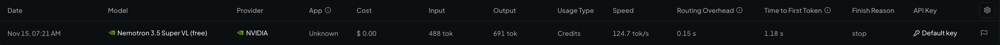

# ride-matcher

Matches one ride request to a driver with a two-node LangGraph graph:

1. **`rank_drivers`** (plain code) keeps only that request's drivers whose status is exactly `available` and ranks them by estimated road pickup minutes, not straight-line distance.
2. **`pick_driver`** sends only that checked list to the OpenRouter model named in `config.json`, asks it to pick one driver and give an arrival estimate, and accepts the answer only if the driver is on the list. Otherwise, or when no driver is available, the graph returns a no-match result.

## Run output: `RQ-0306-012`

`RQ-0306-012` is a bridge-case request (Rose Quarter, east side) where straight-line distance and road time disagree.

```
$ .venv/bin/python ride_graph.py RQ-0306-012
Request:          RQ-0306-012
Assigned driver:  DRV-45581
Arrival estimate: 3 min (ETA 2025-03-06T19:15:40-08:00)
Why:              DRV-45581 is 0.61 km away but 3 road minutes out, beating DRV-17239, which is nearer at 0.36 km but needs 9 road minutes (Freight hold at SE Division Pl rail crossing; routed via SE 11th Ave).
```

**Why DRV-45581 won:** DRV-17239 looked nearest at 0.36 km, but a freight hold at the SE Division Pl rail crossing makes it 9 road minutes away, while DRV-45581 reaches the pickup in 3.

### OpenRouter Activity

The model call for this run (`nvidia/nemotron-3.5-super-vl:free`):



## Plan-mode prompt

> Plan a two-node LangGraph graph for one ride request. Node one is plain code: it keeps only that request's available drivers from the drivers snapshot and ranks them by estimated road pickup minutes, not straight-line distance. Node two sends only that checked list to the OpenRouter model named in config and asks it to pick one driver and give an arrival estimate. Do not write any code yet.

## Pushback

The first plan had no safe outcome when matching failed: if the model returned an invalid answer it silently assigned the top-ranked driver anyway, and a request with no available drivers just ended with no defined result. The approved plan closed this by having node two check that the returned driver is on the checked list and return an explicit no-match result (`driver_not_on_list`, `invalid_model_response`, `model_error`, or `no_available_drivers`) instead of a driver.

## Data

- `data/Uber Ride Requests Test Set (week of 3-9 March 2025).csv`: 20 ride requests (pickup zone, coordinates, river side, bridge/disagreement flags).
- `data/Uber Candidate Drivers Snapshot (week of 3-9 March 2025).csv`: 80 candidate driver rows across the requests (status, position, straight-line km vs. road pickup minutes, route notes).

## Setup

1. `python3 -m venv .venv && .venv/bin/pip install -r requirements.txt`
2. Copy `.env.example` to `.env` and set `OPENROUTER_API_KEY`. `.env` is gitignored; the key is read only from that environment variable.
3. The OpenRouter model id lives in `config.json` (`openrouter_model`).
4. Run: `.venv/bin/python ride_graph.py <request_id>`
